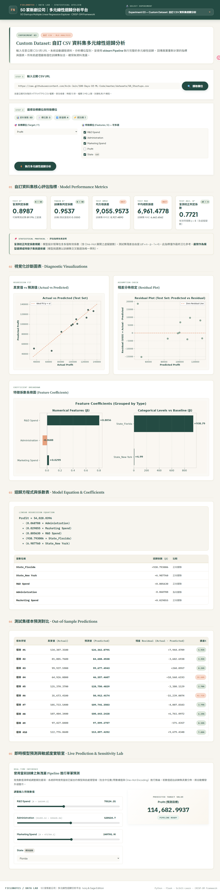

# 50 Startups MLR Explorer

**Multiple Linear Regression ✦ Feature Selection ✦ Flask ✦ CRISP-DM**

> 遵循 CRISP-DM 方法論，以 **Ivory & Sage — Editorial Data Lab** 設計風格打造的
> 端對端多元線性迴歸互動式機器學習分析平台。

---

## 🌐 線上展示與互動網站

| 項目 | 連結 |
| :--- | :--- |
| **GitHub Repository** | [g115064011-arch / 50-startups-mlr-explorer](https://github.com/g115064011-arch/50-startups-mlr-explorer) |
| **Vercel Live Demo** | [https://50-startups-mlr-explorer.vercel.app/](https://50-startups-mlr-explorer.vercel.app/) |

### 網站首頁截圖

> ⚠️ **截圖說明**：以下圖片欄位已預留路徑，請依本機執行方式啟動網站後，
> 開啟瀏覽器至 `http://localhost:5000`，手動截圖並以 **1920×1080** 解析度儲存至 `docs/images/`。

| 功能 | 截圖 |
| :--- | :--- |
| 網站首頁與 EX1 主分析區域 |  |
| EX2 五種演算法比較與 k=1~5 折線圖 |  |
| EX3 自訂 CSV 分析與即時預測滑桿 |  |

---

## 🖥️ 本機執行方式

### Python 環境需求

- Python 3.10 以上
- 建議使用 venv 虛擬環境

```bash
# 1. 建立並啟動虛擬環境
python -m venv venv
# Windows
venv\Scripts\activate
# macOS / Linux
source venv/bin/activate

# 2. 安裝相依套件
pip install -r requirements.txt

# 3. 產生 Experiment 01 分析結果（首次執行必要）
python main.py

# 4. 啟動 Flask 網頁伺服器
python app.py
```

開啟瀏覽器訪問：[http://localhost:5000](http://localhost:5000)

---

## 🔌 Flask REST API

以下為 `app.py` 實際定義的所有 API 端點：

| HTTP 方法 | 路徑 | 說明 |
| :---: | :--- | :--- |
| `GET` | `/` | 載入互動式儀表板前端主頁面 |
| `GET` | `/api/problem1` | 取得 EX1 模型指標、迴歸係數、Base64 圖表與 CRISP-DM 六階段說明 |
| `GET` | `/api/problem2` | 取得五種特徵選擇方法的 CV 結果與測試集盲測數據（含記憶體快取） |
| `POST` | `/api/problem2/refresh` | 強制清除 Problem 2 快取並重新計算所有演算法 |
| `POST` | `/api/custom/analyze` | 從公開 CSV URL 下載資料，回傳欄位型別與缺失值分析 |
| `POST` | `/api/custom/run` | 對自訂資料集執行 MLR Pipeline，回傳指標、迴歸方程式與圖表 |
| `POST` | `/api/custom/predict` | 即時單筆預測，含外插區間警示 |
| `GET` | `/results/<filename>` | 直接存取 `results/` 目錄中的輸出圖檔 |

### 範例 Request（自訂資料集分析）

**Step 1 — 分析欄位**
```json
POST /api/custom/analyze
{ "url": "https://raw.githubusercontent.com/mwaskom/seaborn-data/master/tips.csv" }
```

**Step 2 — 執行 MLR 分析**
```json
POST /api/custom/run
{
  "url": "https://raw.githubusercontent.com/mwaskom/seaborn-data/master/tips.csv",
  "target": "tip",
  "features": ["total_bill", "size", "sex", "smoker", "day", "time"]
}
```

**Step 3 — 即時預測**
```json
POST /api/custom/predict
{
  "inputs": {
    "total_bill": 20.5, "size": 2, "sex": "Female",
    "smoker": "No", "day": "Sat", "time": "Dinner"
  }
}
```

---

## ✨ 核心功能介紹

### 🔬 Experiment 01：OLS 多元線性迴歸分析

依循 **CRISP-DM 六大階段**，對 50 家新創公司資料建立多元線性迴歸模型。

**網站實際功能：**
- CRISP-DM 六階段說明卡片（點擊可展開詳細描述）
- 模型指標面板：Train / Test R²、Adjusted R²、RMSE、MAE
- 迴歸方程式即時展示
- 三張分析圖表（Ivory & Sage 配色）：真實值 vs 預測值、殘差圖、特徵係數雙向條形圖
- 逐筆預測表（50 筆資料的真實值、預測值、殘差）

---

### ⚡ Experiment 02：五種特徵選擇演算法比較

**網站實際功能：**
- 五種演算法並排比較表格
- **k=1～5 動態折線圖**：即時顯示各演算法在不同特徵數下的 CV 分數走勢
- 最佳特徵子集高亮顯示（Warm Apricot 強調色）
- 明確區分「Train CV 指標」（模型選擇依據）與「Test 指標」（盲測驗證）
- RFE 淘汰歷程排名（Rank 1=保留，數字愈大=愈早淘汰）

**核心設計原則**：所有演算法之特徵挑選**僅使用訓練集 5-Fold CV**，測試集絕不作為模型選擇依據。

---

### 🌐 Experiment 03：自訂 CSV 資料集 MLR 分析

**網站實際功能：**
- **CSV URL 輸入框**：支援任意公開 CSV 連結（含安全性驗證與逾時保護）
- **Target / Features 選擇器**：自動偵測欄位型別，下拉選單呈現
- **重新訓練 MLR**：後端即時執行 sklearn Pipeline 並回傳完整分析結果
- **即時預測滑桿**：每移動一個滑桿，透過 `/api/custom/predict` 即時計算預測值
- **外插區間警示**：若輸入值超出訓練集範圍，顯示橙色警示
- **類別欄 One-Hot Encoding**：自動以訓練集類別基準組進行編碼

---

## 📊 核心實驗結果

### Experiment 01 — 50 Startups OLS 多元線性迴歸

資料切分：`train_test_split(test_size=0.2, random_state=42)` — 訓練集 N=40、測試集 N=10

| 指標 | 訓練集（Train） | 測試集（Test） |
| :--- | :---: | :---: |
| **R²** | 0.9537 | 0.8987 |
| **Adjusted R²** | — | 0.7721（p=5, df=4） |
| **RMSE** | $5,370.47 | $9,055.96 |
| **MAE** | $4,289.87 | $6,961.48 |

**迴歸方程式**（State 基準組：California）：

```
Profit = 54,032.55
       + 0.8056 x R&D Spend
       - 0.0688 x Administration
       + 0.0299 x Marketing Spend
       + 938.79 x State_FL
       +   6.99 x State_NY
```

> 係數代表「控制其他變數時的統計關聯性」，非因果關係。
> 訓練/測試 R² 差距（~0.055）主要反映小樣本（測試集 N=10）之隨機切分敏感性。

---

## 🔬 五種特徵選擇演算法比較

**模型選擇依據為訓練集 5-Fold CV R²，測試集結果為事後盲測驗證，不得作為選擇依據。**

| 演算法 | 入選特徵組合 | 特徵數 | Train CV R² | Test R² | Test RMSE |
| :--- | :--- | :---: | :---: | :---: | :---: |
| **Baseline（全特徵）** | 全部 5 項 | 5 | 0.9167 | 0.8987 | $9,055.96 |
| **LassoCV** | R&D, Marketing, State_FL | 3 | 0.9399 | 0.9001 | $8,995.14 |
| **Forward SFS** ⭐ | R&D, Marketing | 2 | **0.9416** | **0.9168** | **$8,206.32** |
| **RFE** | R&D, Admin, Marketing | 3 | 0.9340 | 0.8987 | $9,055.96 |
| **ElasticNetCV** | R&D, Marketing, State_FL | 3 | 0.9399 | 0.9001 | $8,995.14 |
| **Exhaustive Search** ⭐ | R&D, Marketing | 2 | **0.9416** | **0.9168** | **$8,206.32** |

**核心發現**：Forward SFS 與 Exhaustive Search 一致選出 `[R&D Spend, Marketing Spend]`（k=2），
訓練 CV（0.9416）與盲測 R²（0.9168）均達最優，成功剔除雜訊並提升泛化能力。

### 演算法原理說明

| 演算法 | 技術原理 |
| :--- | :--- |
| **LassoCV** | L1 正則化，由 5-Fold CV 自動搜尋最佳 α，將無貢獻特徵壓縮至零 |
| **Forward SFS** | 貪婪向前搜尋：每次加入使 5-Fold CV R² 提升最多的特徵 |
| **RFE** | 遞歸消除：反覆擬合迴歸，每輪淘汰係數絕對值最小的特徵 |
| **ElasticNetCV** | L1+L2 混合正則化，5-Fold CV 搜尋最佳 α 與 l1_ratio |
| **Exhaustive Search** | 窮舉 2⁵−1=31 種非空子集，以訓練集 5-Fold CV R² 選出全域最優 |

---

## 📁 Repository Structure

```text
50-startups-mlr-explorer/
├── README.md
├── requirements.txt
├── vercel.json
├── .gitignore
├── .vercelignore
├── main.py                   # EX1 主分析：CRISP-DM、OLS 迴歸、圖表輸出
├── app.py                    # Flask 後端：REST API 路由與 Web 儀表板
├── analysis/
│   ├── problem2.py           # EX2：五種特徵選擇演算法
│   ├── custom_dataset.py     # EX3：自訂 CSV URL、MLR Pipeline、即時預測
│   ├── test_consistency.py   # 7 項自動化一致性測試
│   ├── test_api.py           # API 端點連線測試
│   ├── test_custom_api.py    # 自訂 Dataset API 測試
│   ├── test_live_api.py      # 即時預測 API 測試
│   ├── test_local_50startups.py  # 本機一致性驗證
│   ├── test_p2.py            # Problem 2 快速測試
│   └── verify_all.py         # 全套整合測試
├── data/
│   └── 50_Startups.csv       # 50 家美國新創公司資料集
├── results/
│   ├── model_summary.json
│   ├── actual_vs_predicted.png
│   ├── residual_plot.png
│   └── feature_coefficients.png
├── templates/
│   └── index.html            # Editorial Data Lab 前端主頁面
├── static/
│   ├── style.css             # Ivory & Sage 設計規範樣式表
│   └── script.js             # 前端互動邏輯、API 串接、Canvas 折線圖
└── docs/
    └── images/
        ├── dashboard_demo.png
        ├── feature_selection_demo.png
        └── custom_dataset_demo.png
```

---

## ☁️ Deployment

### GitHub Repository
```
https://github.com/g115064011-arch/50-startups-mlr-explorer
```

### Vercel 部署架構

- `vercel.json` 已設定 Flask `app` 作為 WSGI 入口，靜態資源與 API 請求統一由 Flask 路由處理
- `matplotlib` 使用非互動式 `Agg` 後端，相容 Linux 唯讀環境
- 所有資料路徑使用相對路徑，不依賴 Windows 絕對路徑
- EX1/EX2 使用記憶體快取或靜態 JSON，不寫入專案目錄
- EX3 自訂模型快取使用 Python 全域變數（Serverless 每次冷啟動重置）

> 🚀 **Live Demo 網址**：[https://50-startups-mlr-explorer.vercel.app/](https://50-startups-mlr-explorer.vercel.app/)

---

## 🙏 Acknowledgments & References

| 資源 | 說明 |
| :--- | :--- |
| **50 Startups Dataset** | Kaggle 公開資料集，50 家美國新創公司研發/行政/行銷支出與年度利潤 |
| **tips.csv** | Seaborn 內建範例資料集，用於 EX3 自訂 CSV 功能測試 |
| **Flask** | Python 輕量級 Web 框架，REST API 與 Web 儀表板服務 |
| **scikit-learn** | Pipeline、LinearRegression、ColumnTransformer、LassoCV、ElasticNetCV、RFE、SFS |
| **pandas** | 資料讀取、清洗、缺失值處理與特徵工程 |
| **NumPy** | 數值運算與矩陣操作 |
| **Matplotlib** | Ivory & Sage 配色分析圖表（Agg 後端） |
| **requests** | 自訂 CSV URL 下載（含 SSRF 防護與逾時限制） |
| **CRISP-DM** | 跨行業資料探勘標準流程方法論 |
| **StatsUnlock** | 介面設計風格參考（Editorial Data Lab 視覺概念） |

---

<div align="center">

**50 Startups MLR Explorer**

*Ivory & Sage — Editorial Data Lab Edition*

`Multiple Linear Regression` · `Feature Selection` · `Flask REST API` · `CRISP-DM`

</div>
